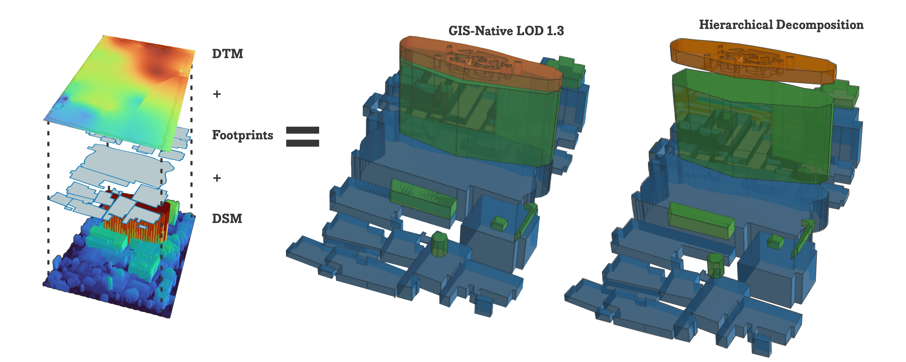
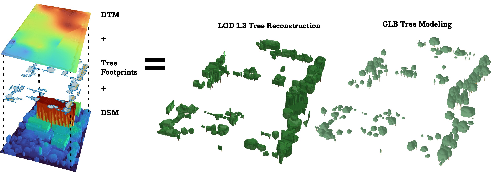

<p align="center">
  <picture>
    <source media="(prefers-color-scheme: dark)" srcset="docs/assets/branding/atap-logo-dark.png">
    <source media="(prefers-color-scheme: light)" srcset="docs/assets/branding/atap-logo-light.png">
    
  </picture>
</p>

<p align="center">
  <strong><a href="https://atap.enygma.id/">Live Preview</a></strong>
  ·
  <a href="#quick-start">Quick Start</a>
  ·
  <a href="#sample-datasets">Sample Datasets</a>
</p>

<p align="center">
  <strong>ATAP Terrain-Aware Architectural Polygonization</strong><br>
  GIS-native terrain-aware hierarchical 3D representation for buildings and tree canopies.<br>
  Current release: <strong>v0.2.0</strong>
</p>

**[Live Preview](https://atap.enygma.id/)** · [Quick Start](#quick-start) · [Sample Dataset](#sample-dataset)

**Founded and stewarded by Enygma.**  
Legal entity: **PT Enygma Solusi Negeri**

## Overview

ATAP is an open-source, GIS-native research and engineering framework for
terrain-aware polygonization and hierarchical 3D representation.

The canonical representation remains ordinary GIS geometry enriched with
hierarchy and vertical semantics. Rendering meshes, procedural geometry, and
engine-specific assets are treated as downstream representations rather than
the primary source of truth.

For buildings, ATAP explores whether useful three-dimensional building-mass
information can remain canonical as ordinary GIS polygon geometry instead of
requiring an explicit mesh or BIM object as the primary representation.

<picture>
  <source media="(prefers-color-scheme: dark)" srcset="docs/assets/overview/atap-banner-dark.png">
  <source media="(prefers-color-scheme: light)" srcset="docs/assets/overview/atap-banner-light.png">
  
</picture>

Current building research direction:

```text
Authoritative building footprint
+
DSM
+
DTM
↓
Terrain normalization
nDSM = DSM - DTM
↓
Hierarchical building-mass decomposition
↓
GIS-native polygon geometry
+
vertical semantics
+
parent/child relationships
```

The current stable building profile is focused on hierarchical LoD1.x /
LoD1.3-style building-mass representation.

ATAP does not currently claim formal LoD2 conformance, complete roof
reconstruction, or BIM equivalence.

## Why ATAP Exists

ATAP grew from practical digital-twin and geospatial project work where a
3D-object-first representation was often more complex than the actual
operational need.

The project follows a fit-for-purpose principle:

> Use the least complex canonical representation that preserves the information
> required by the intended analysis and downstream use.

ATAP therefore separates:

```text
canonical GIS representation
```

from:

```text
downstream rendering, tiling, streaming, procedural assets, and GPU optimization
```

Read the full rationale in
[`docs/rationale.md`](./docs/rationale.md).

## GIS-Native by Design

ATAP treats GIS-native representation as a first-class architectural principle.

A canonical ATAP part may remain a Polygon or MultiPolygon while carrying
useful 3D meaning through attributes such as:

```text
object_id
part_id
parent_part_id
part_level
ground_elevation_m
base_height_agl_m
top_height_agl_m
part_height_m
area_m2
volume_m3
```

A downstream renderer may extrude, triangulate, instance, or decorate those
features temporarily without changing the canonical data model.

ATAP is intended to remain consumable by conventional GIS tooling, spatial
databases, and multiple geospatial rendering engines such as deck.gl,
MapLibre GL, CesiumJS, and other WebGL/WebGPU-based systems.

See [`docs/gis-native-principles.md`](./docs/gis-native-principles.md).

## Quick Start

Python 3.10 or newer is required. End users can install the engine and local
playground with pip:

```sh
python -m venv .venv
# Windows PowerShell: .\.venv\Scripts\Activate.ps1
# Linux/macOS: source .venv/bin/activate
python -m pip install ".[server]"
python tools/make_synthetic.py --out .cache/syn --dataset stepped
atap run --input-geojson .cache/syn/stepped/footprints.geojson --dsm .cache/syn/stepped/dsm.tif --dtm .cache/syn/stepped/dtm.tif --output .cache/stepped.geojson --id-field id
atap serve
```

Contributors can use the same commands on Windows, Linux, and macOS without
activating a shell:

```sh
uv sync --extra dev
uv run python tools/make_synthetic.py --out .cache/syn --dataset stepped
uv run pytest
uv run ruff check .
uv run atap serve
```

`uv` creates and uses `.venv`. Shell activation is optional.

See the [CLI](docs/cli.md), [playground](docs/playground.md),
[method](docs/method.md), [tree method](docs/tree_method.md),
[tree requirements](docs/tree_requirements.md), and
[output schema](docs/output-schema.md).

## Tree & Carbon Mode (`--mode tree`)

ATAP v0.2.0 extends the same terrain-aware GIS-native approach beyond building
masses to tree canopies.

Tree mode processes canopy polygons, DSM, and DTM into hierarchical LoD 1.3
canopy volumes, procedural trunk representations, Individual Tree Detection
outputs, and remote-sensing allometric carbon estimates.

<picture>
  <source media="(prefers-color-scheme: dark)" srcset="docs/assets/overview/atap-tree-dark.png">
  <source media="(prefers-color-scheme: light)" srcset="docs/assets/overview/atap-tree-light.png">
  
</picture>

Run tree mode with:

```sh
atap run \
  --mode tree \
  --input-geojson canopy_footprints.geojson \
  --dsm dsm.tif \
  --dtm dtm.tif \
  --output output_trees.geojson
```

Standard outputs include:

- `output_trees.geojson`: hierarchical elevated canopy tiers above the modeled trunk zone.
- `output_trees_points.geojson`: companion 3D tree points for trunk or model instancing.
- `output_trees_summary.json`: survey-level tree and carbon aggregates.

Tree mode includes:

- canopy elevation from `nDSM = DSM - DTM`;
- Individual Tree Detection for multi-tree crown clusters;
- hierarchical canopy tiers;
- procedural trunk placement;
- remote-sensing allometric estimates for DBH, biomass, carbon, and CO2e.

Carbon and biomass attributes are empirical remote-sensing estimates, not direct
terrestrial measurements. Their methodological scope and limitations are
documented explicitly.

Read the scientific method in
[`docs/tree_method.md`](./docs/tree_method.md), the data and model requirements
in [`docs/tree_requirements.md`](./docs/tree_requirements.md), and the viewer
guide in [`docs/tree_viewer_guide.md`](./docs/tree_viewer_guide.md).

## Sample Datasets

ATAP includes ready-to-use sample datasets for reproducible research, testing,
and demonstration.

### Building Sample

[`samples/atap-sample-area-01/`](samples/atap-sample-area-01/)

Contains:

- DSM
- DTM
- manually delineated building footprints created by Enygma

### Tree Sample

[`samples/atap-sample-tree-01/`](samples/atap-sample-tree-01/)

Contains tree-mode sample inputs and lightweight normalized tree model assets
for testing the tree workflow.

Explore browser-based ATAP output and interaction in the
[ATAP Live Preview](https://atap.enygma.id/).

Each sample directory contains its own documentation, attribution information,
integrity manifest, and applicable data-license notice.

Sample data are licensed separately from the ATAP software. Refer to the
license file inside each sample directory for the applicable terms.

## Editions

### Community Edition

ATAP Community Edition is the canonical public open-source edition.

Covered source code is licensed under:

**GNU Affero General Public License, Version 3 only (`AGPL-3.0-only`)**

The complete license text is in [`LICENSE`](./LICENSE).

### Enterprise Edition

ATAP Enterprise Edition is a separate commercial offering from Enygma for
organizations requiring proprietary integration rights, OEM arrangements,
enterprise support, private extensions, or other separately negotiated terms.

See [`ENTERPRISE.md`](./ENTERPRISE.md).

## Project Identity

| Item | Value |
|---|---|
| Project | ATAP |
| Expanded name | ATAP Terrain-Aware Architectural Polygonization |
| Current public release | v0.2.0 |
| Founding Organization | Enygma |
| Project Steward | Enygma |
| Legal entity | PT Enygma Solusi Negeri |
| Community license | AGPL-3.0-only |

Founding attribution is recorded in
[`FOUNDING_TEAM.md`](./FOUNDING_TEAM.md).

The chronological development history is documented separately in
[`docs/project-history.md`](./docs/project-history.md).

## Research Software

ATAP is developed as research software, not merely as a utility script.

The repository is intended to maintain:

- public development history;
- reproducible reference cases;
- explicit limitations and failure cases;
- tests and validation;
- tagged releases;
- research-oriented documentation;
- dependency and licensing provenance;
- a publication-ready paper history.

Methodological and technical documentation is maintained under
[`docs/`](./docs/), while the working JOSS-oriented paper skeleton is under
[`paper/`](./paper/).

## AI-Assisted Development

ATAP uses LLM systems as engineering and research-assistance tools.

The project follows this principle:

> **Human-originated, AI-assisted, human-validated.**

The research problem, architectural direction, methodological decisions,
validation, interpretation, and final acceptance remain human responsibilities.

See [`docs/ai-usage.md`](./docs/ai-usage.md).

## Contributing

See [`CONTRIBUTING.md`](./CONTRIBUTING.md).

External contributions are subject to the project contribution policy and,
where required, the ATAP Contributor License Agreement in [`CLA.md`](./CLA.md).

## Third-Party Software

Third-party software remains under its own upstream license terms.

See:

- [`THIRD_PARTY_NOTICES.md`](./THIRD_PARTY_NOTICES.md)
- [`third-party/`](./third-party/)

## Status

Current public release: **v0.2.0**.

ATAP v0.2.0 provides tested building and tree processing workflows, including
terrain normalization, hierarchical GIS-native representation, tree-mode
Individual Tree Detection, procedural trunk support, and documented sample
datasets.

Development remains active. Public APIs, schemas, algorithms, parameters, and
output semantics may continue to evolve before a stable 1.0 release.
